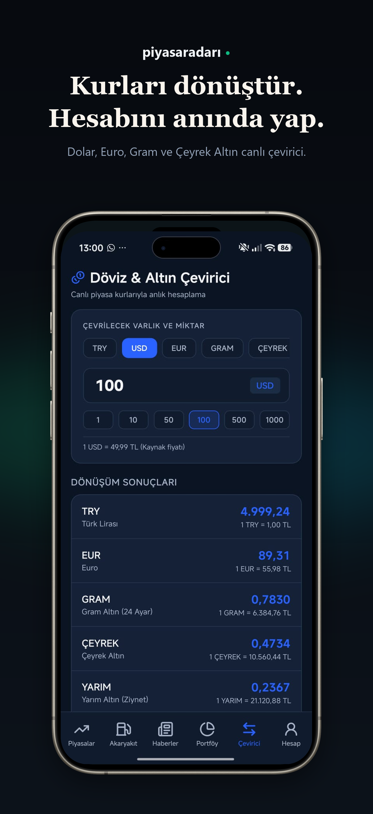

# 📈 PiyasaRadarı (PiyasaTakipApp) – Canlı Finans & Piyasa Takip Platformu
### **BIST 100 Hisseleri, Canlı Döviz, Altın, Kripto, Akaryakıt Fiyatları, Portföy Yönetimi ve Cloudflare Edge Cache Destekli Modern Finans Uygulaması (React Native + Expo SDK 57 + TypeScript + Zustand + Cloudflare Workers)**

---

## 🚀 Proje Hakkında

**PiyasaRadarı (PiyasaTakipApp)**; yatırımcılar, serbest piyasa takipçileri ve bireysel kullanıcılar için Borsa İstanbul (BIST 100), serbest piyasa döviz kurları, altın türleri, emtialar, kripto paralar ve 81 ilin güncel akaryakıt fiyatlarını tek ekranda anlık olarak sunan modern, hızlı ve cross-platform (iOS, Android, Web) bir **React Native (Expo SDK 57)** uygulamasıdır.

Finansal mobil uygulamalarda en büyük sorun; Yahoo Finance ve benzeri küresel veri kaynaklarına doğrudan istek atıldığında yaşanan CORS engelleri, dakikalık istek limitleri (429 Too Many Requests) ve yavaş veri çekme süreleridir. **PiyasaRadarı**, kendi mimarisine özel olarak geliştirilmiş **Cloudflare Edge Cache Proxy** mikroservisi ile tüm BIST ve piyasa verilerini 60 saniyelik akıllı önbellek (`caches.default`) ve 10'arlı eşzamanlı toplu sorgu (Batch Request) havuzlarıyla işler; kullanıcılara gecikmesiz, kota engeline takılmayan akıcı bir piyasa deneyimi yaşatır.

---

## 📌 İçindekiler
- [Temel Özellikler](#-temel-özellikler)
- [Öne Çıkan Modüller](#-öne-çıkan-modüller)
- [Cloudflare Edge Cache & Proxy Mimarisi](#-cloudflare-edge-cache--proxy-mimarisi)
- [Kullanılan Teknolojiler](#-kullanılan-teknolojiler)
- [Ekran Görüntüleri](#-ekran-görüntüleri)
- [Proje Dizin Yapısı](#-proje-dizin-yapısı)
- [Kurulum ve Çalıştırma](#-kurulum-ve-çalıştırma)
- [Gizlilik ve Güvenlik](#-gizlilik-ve-güvenlik)
- [Yasal Uyarı ve Sorumluluk Reddi](#-yasal-uyarı-ve-sorumluluk-reddi)
- [Geliştirici ve İletişim](#-geliştirici-ve-iletişim)

---

## ✨ Temel Özellikler

- 📊 **Kapsamlı Canlı Piyasa Yelpazesi:**
  - **Borsa İstanbul (BIST):** BIST 100 endeksi ve tüm popüler hisse senetleri (THYAO, ASELS, GARAN, TUPRS, EREGL, BIMAS, KCHOL vb.).
  - **Döviz Kurları:** USD/TRY, EUR/TRY, GBP/TRY, CHF/TRY ve çapraz kurlar.
  - **Altın & Emtia:** Gram Altın, Çeyrek Altın, Yarım Altın, Cumhuriyet Altını, Ons Altın ($XAU/USD$) ve Brent Petrol.
  - **Kripto Varlıklar:** Bitcoin (BTC), Ethereum (ETH) ve majör kripto paralar.
- ⚡ **Kayan Canlı Ticker Bandı (`MarketTicker`):** Profesyonel finans ekranlarındaki gibi ekranın üstünde kesintisiz ve akıcı kayan, anlık fiyat ve yüzde değişim şeridi.
- 📈 **İnteraktif Grafikler & Sparklines (`PriceChart` & `MiniSparkline`):** Günlük (1G), haftalık (1H), aylık (1A) ve yıllık (1Y) periyotlarda vektörel SVG trend çizgileri ve detaylı geçmiş fiyat grafikleri.
- 💼 **Kişisel Portföy & Kâr/Zarar Takibi:** Sahip olunan hisse, döviz, altın veya kripto varlıkları alış maliyetiyle kaydetme; anlık piyasa fiyatıyla toplam portföy değerini ve net kâr/zarar tutarını/oranını izleme.
- 💱 **Döviz & Altın Çevirici (Finans Hesap Makinesi):** Canlı kurlar üzerinden anında çift yönlü döviz çevirme ve gram/çeyrek altın alım-satım simülasyonu.
- ⛽ **81 İl Bazlı Canlı Akaryakıt Fiyatları:** Türkiye genelindeki tüm illerde geçerli olan güncel Benzin, Motorin (Dizel) ve LPG otogaz pompa satış fiyatlarını anlık takip edebilme.
- 📰 **Son Dakika Finans Haberleri:** Piyasalara yön veren önemli ekonomik gelişmeler, şirket açıklamaları ve borsa haberleri akışı.
- ⭐ **Favoriler & Hızlı Erişim:** İlgilenilen varlıkları favorilere ekleme; offline önbellekleme ile internet kesintisinde bile son verileri görüntüleme.
- 🎨 **Modern Fintech Dark Mode & Glassmorphism:** OLED ekranlar için optimize edilmiş derin koyu tema (`#0B0E14`), modern buzlu cam efektleri (`expo-glass-effect`), akıcı geçiş animasyonları (`react-native-reanimated`).

---

## 🧠 Öne Çıkan Modüller

### 1. Kayan Canlı Ticker Şeridi (`MarketTicker.tsx`)
Borsa salonlarındaki profesyonel LED panolar gibi tasarlanan ticker bandı, seçilen kritik varlıkların fiyat ve değişim yüzdelerini akıcı bir animasyonla ekrandan geçirir. Kullanıcı istediğinde bandı duraklatabilir veya hızlandırabilir.

### 2. Gelişmiş Varlık Kartı & Detay Modalı (`AssetCard.tsx` & `AssetDetailModal.tsx`)
Her finansal enstrüman için mini sparkline grafiği, en yüksek/en düşük fiyat aralığı, hacim ve değişim yüzdeleri kart üzerinde özetlenir. Karta dokunulduğunda açılan tam ekran modalda derinlemesine geçmiş grafiği, teknik veriler ve favoriye ekleme kontrolleri yer alır.

### 3. Akıllı Portföy Yönetimi (`portfolio.tsx`)
Kullanıcılar alış fiyatını ve miktarını girerek varlıklarını portföye ekler. Uygulama, piyasa dalgalandıkça portföyün toplam piyasa değerini, toplam kâr/zararını ve varlık bazlı getiri oranlarını anlık olarak hesaplayıp görselleştirir.

### 4. İl Bazlı Akaryakıt Takip Modülü (`fuel.tsx`)
Opet kaynağından seçilen ile ait örnek bir ilçenin benzin ve motorin fiyatları sorgulanır; ilçe ve sorgu zamanı gösterilir. İstanbul yakaları ilçe adına göre ayrılır. Doğrulanmış LPG verisi olmadığı için fiyat üretilmez. Bağlantı hatasında en fazla 24 saatlik gerçek kayıt, eski olduğu belirtilerek gösterilir; kayıt yoksa fiyat alanı boş kalır.

Zam/indirim bölümü Google Haberler ve Bloomberg HT RSS üzerinden son 3 güne ait ilgili başlıkları, yayın tarihini ve kaynak bağlantısını gösterir. Haberler resmî fiyat teyidi sayılmaz. Kaynakların erişimi garanti değildir; hata, boş sonuç ve teyit eksikliği açıkça belirtilir. Brent/döviz hareketinden pompa fiyatı veya EPDK kararı üretilmez. Depo hesaplayıcısında litre başına senaryo tutarını kullanıcı girer; boş girdi sıfır kabul edilmez.

### Grafik düzeltmesi ve kontroller

Geçmiş fiyatlar çalışan `/batch` yolundan, hata olursa `/chart` yolundan alınır. Worker tekli sembol yolunda `GC%3DF` ve `USDTRY%3DX` değerlerini yalnızca bir kez çözer; eski çift kodlama 404 hatasına neden oluyordu. Mobil düzeltme mevcut Worker'ın batch yoluyla çalışır; Worker değişikliği ayrıca dağıtılabilir.

Altın grafikleri dönemin ons vadeli fiyatı ve USD/TRY geçmişinden teorik has değer olarak hesaplanır; Truncgil alış/satış geçmişi değildir. Geçmiş seri bugünkü fiyata oranlanmaz. Dönemler birbirinden bağımsızdır; başarısız istekte sahte zamanlarla gün içi seri gösterilmez. Kaynak hatasında yeniden deneme seçeneği vardır.

```bash
npm ci
npm test
npm run typecheck
npm run lint
```

Regresyon testleri geçmiş dönemleri, tarih/kur eşlemesini, hata/önbellek davranışını, Worker sembol kodlamasını ve akaryakıt veri eksikliğini kapsar. Yerel kontroller ve canlı geçmiş API doğrulaması imzalı iOS/Android derlemesi veya fiziksel cihaz testi yerine geçmez.

---

## 🌐 Cloudflare Edge Cache & Proxy Mimarisi

Uygulamanın arkasında çalışan `cloudflare-worker` mikroservisi, mobil uygulamanın performansını ve sürekliliğini garanti altına alır:

```
[Mobil Uygulama / Web]
         │
         ▼
[Cloudflare Edge Cache (60s TTL)] ──(Cache Hit: <25ms)──► [Kullanıcıya Anında Yanıt]
         │ (Cache Miss)
         ▼
[10'lu Paralel Eşzamanlı İstek Havuzu]
         ├──► Yahoo Finance API (BIST 100 & Emtia)
         ├──► Truncgil Finans API (Serbest Piyasa Döviz & Altın)
         └──► Akaryakıt Servisleri
```

- ⚡ **60 Saniye Edge Cache:** Cloudflare CDN üzerinde 60 saniye boyunca saklanan veriler sayesinde aynı anda binlerce kullanıcı istek atsa dahi veri kaynaklarına dakikada yalnızca 1 istek gider.
- 📦 **Batch Request Desteği:** Tek bir HTTP isteği ile 100 farklı BIST hissesi virgülle ayrılarak topluca çekilebilir (`/batch?symbols=THYAO.IS,GARAN.IS...`).
- 🛡️ **Tam CORS Çözümü:** `Access-Control-Allow-Origin: *` başlıkları sayesinde hem mobil uygulamalarda hem de Web önizlemelerinde sıfır CORS hatası.

---

## ⚙️ Kullanılan Teknolojiler

<p align="center">
  
  
  
  
  
  
  
  
  
</p>

---

## 📸 Ekran Görüntüleri

| **01. Canlı Piyasa & Ticker** | **02. Detaylı Grafik & Hisse Analizi** | **03. Portföy & Kâr/Zarar Takibi** |
| :---: | :---: | :---: |
|  |  |  |

<br>

| **04. Döviz & Altın Çevirici** | **05. İl Bazlı Akaryakıt Fiyatları** | **06. Finans & Borsa Haberleri** |
| :---: | :---: | :---: |
|  |  |  |

---

## 📁 Proje Dizin Yapısı

```bash
PiyasaTakipApp/
├── assets/                     # İkonlar, logolar, yazı tipleri ve görsel varlıklar
├── cloudflare-worker/          # Cloudflare Edge Cache Proxy mikroservisi
│   ├── src/                    # Worker istek yönlendiricisi ve cache algoritmaları
│   ├── wrangler.toml           # Cloudflare Worker yapılandırması
│   └── README.md               # Proxy dokümantasyonu ve dağıtım kılavuzu
├── docs/                       # Dokümantasyon ve ekran görüntüleri
│   └── screenshots/            # README ve mağaza vitrin görselleri
├── src/                        # Mobil uygulama kaynak kodları
│   ├── api/                    # Veri servisleri (Market, Fuel, News ve config)
│   ├── app/                    # Expo Router dosya tabanlı navigasyon
│   │   ├── (tabs)/             # Ana sekmeler (Piyasa, Portföy, Çevirici, Akaryakıt, Haberler)
│   │   └── _layout.tsx         # Kök tema ve navigasyon düzeni
│   ├── components/             # Kartlar, grafikler, ticker ve UI bileşenleri
│   │   ├── AssetCard.tsx       # Varlık özet kartı
│   │   ├── AssetDetailModal.tsx# Detaylı grafik ve analiz modalı
│   │   ├── MarketTicker.tsx    # Kayan canlı borsa şeridi
│   │   ├── PriceChart.tsx      # SVG tabanlı geçmiş fiyat grafiği
│   │   └── MiniSparkline.tsx   # Liste içi mini trend çizgisi
│   ├── constants/              # Fintech renk paletleri ve tema sabitleri
│   ├── hooks/                  # Tema ve canlı piyasa verisi custom hook'ları
│   ├── store/                  # Zustand state yönetimi (marketStore, favoritesStore)
│   ├── types/                  # TypeScript veri modelleri ve arayüzler
│   └── utils/                  # Para/fiyat formatlayıcıları ve altın hesaplayıcı
├── app.json                    # Expo ve EAS proje yapılandırması
└── package.json                # Proje bağımlılıkları ve çalıştırma betikleri
```

---

## 📥 Kurulum ve Çalıştırma

### Gereksinimler
- **Node.js:** `v20.0.0` veya üzeri
- **npm** veya **bun**
- *(İsteğe bağlı)* Telefonunuzda test için **Expo Go** uygulaması

### 1. Repoyu Klonlayın
```bash
git clone https://github.com/Cevdet-Karakulak/PiyasaTakipApp.git
cd PiyasaTakipApp
```

### 2. Bağımlılıkları Yükleyin
```bash
npm install
```

### 3. Uygulamayı Başlatın

#### 📱 Mobil Geliştirme (Expo):
```bash
npx expo start
```
Terminalde oluşan QR kodu telefonunuzun kamerası veya **Expo Go** uygulaması ile taratarak doğrudan cihazınızda test edebilirsiniz.

#### 🌐 Web Önizlemesi:
```bash
npm run web
```
Tarayıcınızda `http://localhost:8081` adresinde açılacaktır.

#### ☁️ Cloudflare Worker Dağıtımı (Opsiyonel):
Kendi proxy sunucunuzu dağıtmak isterseniz:
```bash
cd cloudflare-worker
npx wrangler login
npx wrangler deploy
```

---

## 🔒 Gizlilik ve Güvenlik

- **Yerel Depolama (Offline-First):** Eklediğiniz portföy kayıtları, varlık miktarları ve favoriler tamamen cihazınızda (`AsyncStorage`) saklanır; herhangi bir harici veritabanına iletilmez.
- **Sıfır Kişisel Veri İsteği:** Uygulama üyelik, T.C. kimlik numarası, e-posta veya finansal hesap bilgisi talep etmez.
- **Reklamsız ve Şeffaf:** Kullanıcı deneyimini bozan üçüncü taraf reklam ağları veya izleyiciler bulunmaz.

---

## ⚖️ Yasal Uyarı ve Sorumluluk Reddi

> [!IMPORTANT]
> **PiyasaRadarı (PiyasaTakipApp)** içinde sunulan hisse senedi, döviz, altın, petrol, akaryakıt ve kripto para verileri **yalnızca bilgilendirme amaçlıdır**.
> 
> Uygulama bünyesindeki hiçbir veri, grafik, hesaplama veya haber **Yatırım Tavsiyesi Niteliğinde Değildir (YTD)**. Gerçekleştirilen finansal işlemlerden doğabilecek kâr veya zararlardan uygulama geliştiricisi sorumlu tutulamaz.

---

## 👨‍💻 Geliştirici ve İletişim

**Cevdet Karakulak**  
*Junior Full Stack Developer*

---

<p align="center">
  <sub>Piyasaların nabzını tutun, fırsatları yakalayın. 📈⚡</sub>
</p>

